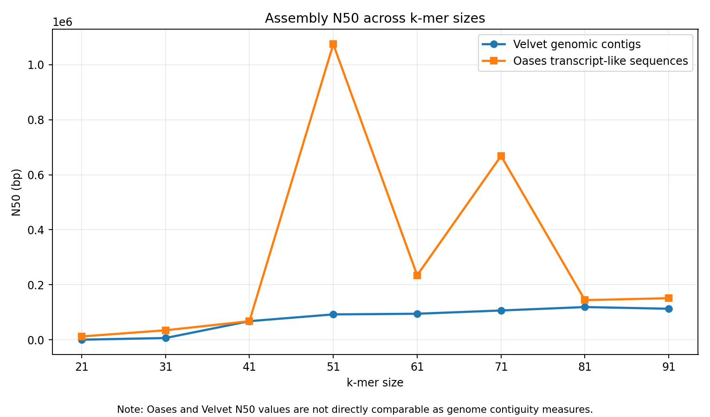
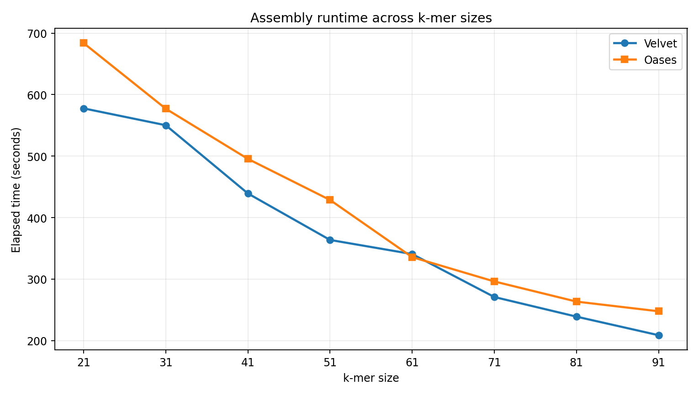

# Ecoli-DeNovo-Genome-Assembly-using-Velvet-and-Oases
Comparative de novo assembly of E. coli Illumina sequencing data (SRR21904868) using Velvet and Oases, with k-mer optimization and QUAST assembly evaluation.

# Comparative De Novo Assembly of *Escherichia coli* Using Velvet and Oases

**Illumina paired-end sequencing | NCBI SRA SRR21904868 | IU Quartz HPC**

## Project overview

This project compares two de novo assembly workflows—**Velvet** and **Oases**—on the same short-read *Escherichia coli* Illumina dataset. Paired-end reads were retrieved from the NCBI Sequence Read Archive, assessed with FastQC, trimmed with fastp, and assembled at **eight k-mer sizes** (21, 31, 41, 51, 61, 71, 81, and 91) for each tool, yielding **16 assembly configurations**. Assemblies were compared using contiguity statistics, sequence counts, total assembled length, and execution time. A reference-free QUAST evaluation was performed on the Velvet assemblies.

**Key finding:** Based on the *highest N50 within each tool*, **Velvet k=81** and **Oases k=51** were selected. Velvet is the more directly appropriate output for this bacterial **genome** assembly task: Oases was developed for **transcriptome** assembly, and its transcript-like sequences can overlap or be redundant. A larger Oases N50 or summed sequence length does **not** demonstrate a more accurate genomic assembly.

## Data and computational environment

| Item | Details |
|---|---|
| Organism | *Escherichia coli* |
| SRA accession | [SRR21904868](https://www.ncbi.nlm.nih.gov/sra/?term=SRR21904868) |
| Sequencing | Illumina paired-end DNA reads |
| Computing platform | Indiana University Quartz HPC (Slurm) |
| Raw read retrieval | SRA Toolkit 3.0.5 (`prefetch`, `fasterq-dump`) |
| Read QC / trimming | FastQC 0.12.1; fastp 0.23.4 |
| Assembly | Velvet 1.2.10; Oases (version not recorded in the supplied report) |
| Assembly evaluation | Python statistics and reference-free QUAST |

The original computation used `/N/slate/puthora/ecoli_assembly_assignment` on IU Quartz. This is a cluster-specific location; reproduce the workflow in a directory appropriate to your own system.

## Analysis workflow

```text
SRR21904868 (SRA)
       |
       v
prefetch + fasterq-dump -> paired FASTQ
       |
       v
FastQC -> fastp adapter trimming
       |
       +------------------------------+
       |                              |
       v                              v
Velvet (8 k-mers)              Oases (8 k-mers)
velveth -> velvetg             velveth -> velvetg -> oases
       |                              |
       v                              v
Genomic contigs                  Transcript-like sequences
       |                              |
       +--------------+---------------+
                      |
                      v
       Metrics: count, total length,
       longest sequence, N50, runtime
                      |
                      v
       Selected assemblies and per-sequence TSVs

Reference-free QUAST was also run on the eight Velvet assemblies.
```

### 1. Download and preprocess reads

The dataset was downloaded with SRA Toolkit, converted to paired-end FASTQ, assessed using FastQC, and adapter-trimmed using fastp (`--detect_adapter_for_pe`). The trimmed files used for both assemblers were:

- `trimmed_data/SRR21904868_1.trimmed.fastq.gz`
- `trimmed_data/SRR21904868_2.trimmed.fastq.gz`

### 2. Assemble at eight k-mer sizes

**Velvet** uses `velveth` and `velvetg`; the reported workflow used paired reads, `-exp_cov auto`, and `-cov_cutoff auto`.

**Oases** uses a Velvet graph created with read tracking (`velvetg -read_trkg yes -exp_cov auto`), followed by `oases` to generate transcript-like paths.

Both tools were run for **k = 21, 31, 41, 51, 61, 71, 81, 91**, and runtimes were recorded using `/usr/bin/time -p`.

### 3. Evaluate assemblies

Sequence counts, total assembled lengths, maximum lengths, and N50 were calculated from the assemblies. QUAST was used **without a reference genome** for the Velvet assemblies (`--min-contig 0`), so the evaluation does **not** establish genome completeness, reference-based correctness, or misassembly counts.

For the full original command record and Slurm settings, see [`docs/README_analysis.txt`](docs/README_analysis.txt). The script links below refer to files you can add from your Quartz project; they are not embedded in this README.

## Key results: selected assemblies

| Metric | Velvet | Oases |
|---|---:|---:|
| Selected k-mer | **81** | **51** |
| Assembly output | Genomic contigs | Transcript-like sequences |
| Number of sequences | **233** | **538** |
| Sum of sequence lengths | **4,783,798 bp** | **16,354,338 bp** |
| N50 | **118,766 bp** | **1,074,872 bp** |
| Longest sequence | 365,827 bp | 1,433,095 bp |
| Elapsed runtime | 238.97 s | 428.68 s |

Selection is **N50-based within each tool**, not a claim that these are globally optimal or reference-validated assemblies. For Velvet, k=91 produced fewer contigs and a longer maximum contig than k=81, but k=81 had the highest N50.

## Comparison across all k-mer sizes

| Tool | k | Sequences | Total length (bp) | N50 (bp) | Runtime (s) |
|---|---:|---:|---:|---:|---:|
| Velvet | 21 | 184,055 | 12,802,649 | 72 | 577.62 |
| Velvet | 31 | 3,331 | 4,834,476 | 6,197 | 550.22 |
| Velvet | 41 | 325 | 4,754,656 | 67,466 | 439.26 |
| Velvet | 51 | 260 | 4,762,303 | 92,070 | 363.68 |
| Velvet | 61 | 247 | 4,770,995 | 94,426 | 340.72 |
| Velvet | 71 | 257 | 4,779,084 | 106,280 | 270.88 |
| **Velvet** | **81** | **233** | **4,783,798** | **118,766** | **238.97** |
| Velvet | 91 | 221 | 4,786,072 | 112,588 | 208.78 |
| Oases | 21 | 2,296 | 12,214,068 | 11,866 | 683.77 |
| Oases | 31 | 855 | 10,889,418 | 34,317 | 577.05 |
| Oases | 41 | 676 | 11,074,137 | 67,383 | 495.48 |
| **Oases** | **51** | **538** | **16,354,338** | **1,074,872** | **428.68** |
| Oases | 61 | 621 | 11,068,718 | 234,411 | 335.72 |
| Oases | 71 | 590 | 13,595,078 | 668,286 | 296.17 |
| Oases | 81 | 599 | 11,010,815 | 143,968 | 263.42 |
| Oases | 91 | 533 | 11,342,118 | 151,034 | 247.69 |

## Visualizations

### N50 by k-mer size



*Figure 1. N50 values across eight k-mer sizes, plotted separately for Velvet and Oases. Their different output types mean that absolute N50 values should not be used as a direct measure of which genomic assembly is more correct.*

### Runtime by k-mer size



*Figure 2. Measured elapsed wall-clock time at each k-mer size. Velvet was faster at seven of eight k-mer sizes in these runs.*

Both figures were generated from the summary values reported in the coursework report; they are visual summaries, not new assembly runs.

## Results and supporting files

The following paths are the **recommended layout** for the GitHub repository. Upload the original files to these paths to activate the links:

| File | Contents |
|---|---|
| [`results/assembly_comparison_all8.csv`](results/assembly_comparison_all8.csv) | Full k-mer comparison from the analysis |
| [`results/velvet_k81_sequence_lengths.tsv`](results/velvet_k81_sequence_lengths.tsv) | Length of each of the 233 selected Velvet contigs |
| [`results/oases_k51_sequence_lengths.tsv`](results/oases_k51_sequence_lengths.tsv) | Length of each of the 538 selected Oases sequences |
| [`report/puthora_report.docx`](report/puthora_report.docx) | Full written report and sequence-length appendix |
| [`docs/README_analysis.txt`](docs/README_analysis.txt) | Original command-by-command analysis README |

### Analysis scripts

These filenames are documented in the original README. **Add the original scripts from Quartz** to the `scripts/` directory; do not substitute untested example scripts without labeling them:

| Stage | Script |
|---|---|
| SRA download | [`scripts/download_ecoli.sh`](scripts/download_ecoli.sh) |
| SRA to FASTQ | [`scripts/convert_ecoli.sh`](scripts/convert_ecoli.sh) |
| FastQC | [`scripts/run_fastqc.sh`](scripts/run_fastqc.sh) |
| Trimming | [`scripts/trim_ecoli.sh`](scripts/trim_ecoli.sh) |
| Assemblies: k=21–61 | [`scripts/run_assemblies.sh`](scripts/run_assemblies.sh) |
| Assemblies: k=71–91 | [`scripts/run_additional_kmers.sh`](scripts/run_additional_kmers.sh) |
| Assembly metrics | [`scripts/analyze_assemblies.py`](scripts/analyze_assemblies.py) and [`scripts/analyze_all_kmers.py`](scripts/analyze_all_kmers.py) |
| Sequence-length exports | [`scripts/export_optimal_lengths.py`](scripts/export_optimal_lengths.py) and [`scripts/export_final_lengths.py`](scripts/export_final_lengths.py) |

## Interpretation and limitations

- **Velvet** is designed for de novo genome assembly, and its `contigs.fa` is more directly relevant for reconstructing the *E. coli* genome.
- **Oases** is primarily intended for transcriptome assembly. Its `transcripts.fa` may contain repeated or overlapping graph paths; its much larger N50 and total sequence length should **not** be taken as evidence of a better *E. coli* genome assembly.
- **N50 is a measure of contiguity, not accuracy**. The k-mer choices here prioritize N50 within each tool; other metrics can favor other k-mers.
- **QUAST was run without a reference** and only on Velvet assemblies. It cannot validate sequence correctness or completeness against an *E. coli* reference genome.
- Runtimes depend on compute resources, software versions, and dataset properties. This comparison describes this dataset and these HPC runs.

## Reproducibility

The full original analysis instructions, commands, input/output locations, and Slurm parameters are documented in `docs/README_analysis.txt`. The root README is a project-level summary; it does not replace that record.

For reproducibility, download the public raw reads from [NCBI SRA: SRR21904868](https://www.ncbi.nlm.nih.gov/sra/?term=SRR21904868), use the commands and environment described in the analysis README, and run the original scripts in order. Large raw FASTQ files, installed software environments, and temporary assembly outputs are intentionally not included in this lightweight portfolio repository.

## Acknowledgment

Completed as part of MS Bioinformatics coursework using the Indiana University Quartz HPC system. Generative AI assisted with documentation, language refinement, and presentation of existing analysis results. The numerical metrics and conclusions reported here are derived from the supplied coursework report and analysis README.
